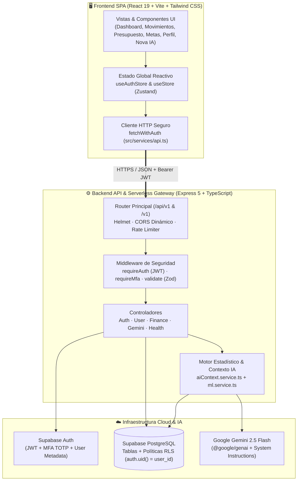
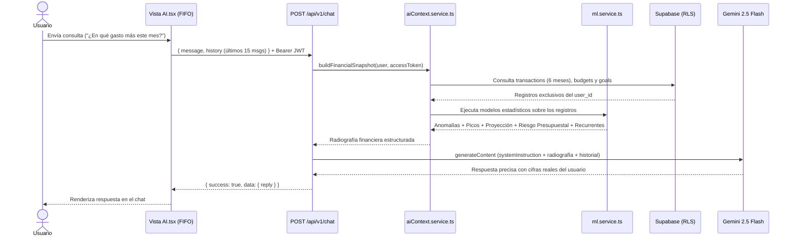
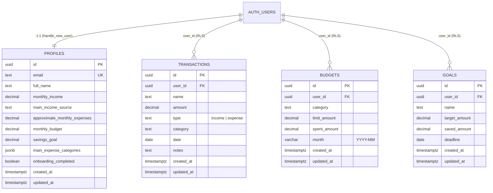

<div align="center">

# ✦ NOVA PLATA
### Plataforma Inteligente de Finanzas Personales & Copiloto con Machine Learning 

[](https://react.dev/)
[](https://www.typescriptlang.org/)
[](https://vite.dev/)
[](https://tailwindcss.com/)
[](https://expressjs.com/)
[](https://supabase.com/)
[](https://ai.google.dev/)
[](https://nova-plata.vercel.app)

<p align="center">
  <strong>Control financiero en tiempo real, aislamiento criptográfico por usuario y análisis predictivo impulsado por IA.</strong>
  <br />
  <a href="https://nova-plata.vercel.app"><strong>🌐 Ver Demo en Producción (Vercel)</strong></a>
  ·
  <a href="#-arquitectura-del-sistema"><strong>Arquitectura</strong></a>
  ·
  <a href="#-motor-de-ia-y-machine-learning-nova-ia"><strong>Motor Nova IA</strong></a>
  ·
  <a href="#-referencia-de-la-api-rest"><strong>API REST</strong></a>
  ·
  <a href="#-instalación-y-despliegue"><strong>Despliegue</strong></a>
</p>

</div>

---

## 📖 Descripción General

**Nova Plata** (repositorio `Mi_Plata2`) es una aplicación web *full-stack* diseñada para la gestión integral de finanzas personales. Combina una interfaz reactiva de alto rendimiento con un backend seguro en **Node.js / Express** y persistencia en **Supabase (PostgreSQL)**, integrando a **Nova IA**: un copiloto financiero capaz de analizar movimientos reales, detectar anomalías estadísticas, proyectar cierres de mes y ofrecer recomendaciones personalizadas sin comprometer la privacidad de cada cuenta.

### ✨ Características Principales

| Módulo | Descripción Funcional |
| :--- | :--- |
| 📊 **Dashboard Ejecutivo** | Resumen en tiempo real del balance disponible, ingresos, egresos, tasa de ahorro mensual, flujo de caja y progreso de objetivos. |
| 💸 **Gestión de Movimientos** | Registro, filtrado multicriterio (categoría, tipo, búsqueda textual) y eliminación de ingresos y gastos sincronizados con PostgreSQL. |
| 🎯 **Presupuestos Inteligentes** | Definición de techos mensuales por categoría con barras de consumo, alertas al superar el 80% y proyección de agotamiento. |
| 🏆 **Metas de Ahorro** | Seguimiento visual de objetivos financieros con cálculo automático del ahorro mensual requerido según la fecha límite. |
| 🤖 **Copiloto Nova IA + ML** | Asistente conversacional conectado a `gemini-2.5-flash` enriquecido con modelos estadísticos propios (anomalías MAD, regresión lineal y run-rate). |
| 🛡️ **Aislamiento Multi-Usuario** | Privacidad total por cuenta mediante filtrado estricto por `user_id`, políticas **Row Level Security (RLS)** en base de datos y purga automática de sesión. |
| 🌓 **Diseño Dual (Dark / Light)** | Estética *Neon Streamer* en modo oscuro con bordes animados (`@property` CSS) y modo claro *Warm Editorial* con persistencia instantánea. |

---

## 🏗️ Arquitectura del Sistema

La plataforma implementa una arquitectura **Monorepo Full-Stack** preparada tanto para ejecución en servidores dedicados como para despliegue **Serverless en Vercel**.



---

## ⚙️ ¿Cómo Funciona Nova Plata? (Flujo Operativo)

### 1. Autenticación, Onboarding y Perfil de Usuario
1. **Registro e Inicio de Sesión (`/login`, `/register`)**: El usuario se autentica contra **Supabase Auth**. El backend valida las credenciales mediante esquemas **Zod** y devuelve un token de sesión JWT.
2. **Onboarding Financiero (`/app/onboarding`)**: Al ingresar por primera vez, el usuario parametriza su ingreso mensual base, fuente principal de ingresos, presupuesto objetivo, meta de ahorro y categorías frecuentes.
3. **Persistencia de Perfil (`/app/perfil`)**: Permite actualizar datos personales, régimen tributario, divisa (`COP`, `USD`, `EUR`), umbral de alerta de anomalías, preferencias de **Nova IA** y foto de perfil (optimizada en servidor para mantener liviano el JWT y evitar errores `HTTP 431`).

### 2. Sincronización Financiera y Aislamiento de Datos
1. **Carga Inicial Reactiva**: Al autenticarse en [`AppLayout.tsx`](src/layouts/AppLayout.tsx), el store [`useStore.ts`](src/store/useStore.ts) invoca `fetchFinancialData()`, realizando consultas paralelas a `/api/v1/finance/transactions`, `/finance/budgets` y `/finance/goals`.
2. **Doble Barrera de Privacidad**:
   - **En el Backend ([`finance.service.ts`](server/src/services/finance.service.ts))**: Se instancia un cliente de Supabase con el JWT del usuario (`createUserClient(accessToken)`) y se filtra explícitamente cada consulta y mutación con `.eq('user_id', userId)`.
   - **En la Base de Datos ([`schema.sql`](server/supabase/schema.sql))**: PostgreSQL aplica políticas **Row Level Security (RLS)** (`USING (auth.uid() = user_id)`), haciendo imposible que una cuenta lea o modifique registros ajenos.
3. **Limpieza en Cambio de Cuenta**: Al ejecutar `logout()` o iniciar sesión con otro usuario en [`useAuthStore.ts`](src/store/useAuthStore.ts), se invoca `clearAllData()` y se purgan `localStorage` y `sessionStorage`, garantizando que un usuario nuevo siempre encuentre su dashboard limpio.

---

## 🧠 Motor de IA y Machine Learning (`Nova IA`)

A diferencia de un chatbot genérico, **Nova IA** combina un modelo fundacional (**Google Gemini 2.5 Flash**) con un motor estadístico determinista ([`ml.service.ts`](server/src/services/ml.service.ts) y [`aiContext.service.ts`](server/src/services/aiContext.service.ts)) que se calcula en tiempo real **exclusivamente sobre los datos del usuario autenticado**.



### Modelos Estadísticos Implementados en [`ml.service.ts`](server/src/services/ml.service.ts)

1. **Detección de Anomalías con Estadística Robusta (`detectAnomalies`)**:
   - Utiliza la **Mediana** y la **Desviación Absoluta Mediana ($\text{MAD}$)** por categoría en lugar de la media simple (evitando que un único gasto extremo distorsione el modelo).
   - Calcula el puntaje robusto:
     $$Z_{\text{robusto}} = \frac{0.6745 \cdot (x - \text{mediana})}{\text{MAD}}$$
   - Marca automáticamente como anomalía todo movimiento con $Z_{\text{robusto}} > 3.5$ y razón $\ge 1.5\times$ el gasto típico, o que supere el umbral personal configurado por el usuario.

2. **Proyección de Fin de Mes y Tendencia (`forecastMonth`)**:
   - **Modelo Híbrido (*Run-Rate* + Histórico)**: Pondera el ritmo de gasto diario del mes actual según la fracción transcurrida del mes ($\alpha = \text{días transcurridos} / \text{días del mes}$) con el promedio histórico de los meses previos:
     $$\text{Gasto Proyectado} = \alpha \cdot \text{RunRate}_{\text{actual}} + (1 - \alpha) \cdot \text{Promedio}_{\text{histórico}}$$
   - **Tendencia con Regresión Lineal**: Calcula la pendiente de mínimos cuadrados ordinarios (OLS) sobre los últimos meses completos para estimar la variación porcentual mensual del gasto.
   - **Gasto Diario Seguro (`safeDailySpend`)**: Determina cuánto puede gastar el usuario por día durante el resto del mes sin exceder su techo presupuestario.

3. **Detección de Picos por Categoría (`detectCategorySpikes`)**:
   - Identifica categorías cuyo gasto acumulado en el mes actual ya supera en $\ge 30\%$ su promedio histórico mensual.

4. **Evaluación de Riesgo Presupuestario (`assessBudgets`)**:
   - Clasifica cada presupuesto activo en tres estados: `ok`, `en_riesgo` ($\ge 80\%$ ejecutado o proyección $> 105\%$ del límite) y `excedido`.

5. **Detección de Gastos Recurrentes y Suscripciones (`detectRecurring`)**:
   - Normaliza las descripciones de los movimientos (sin tildes ni caracteres especiales) e identifica cobros presentes en múltiples meses con montos estables dentro de una banda de $\pm 20\%$ respecto a su mediana.

---

## 🎨 Sistema de Diseño (Design System)

Nova Plata cuenta con una identidad visual propia con soporte nativo para **Modo Oscuro** y **Modo Claro**:

| Token / Elemento | Modo Oscuro (*Neon Streamer*) | Modo Claro (*Warm Editorial*) |
| :--- | :--- | :--- |
| **Fondo Principal (`--bg`)** | `#0B0C0E` (Negro profundo sólido) | `#F6F5F2` (Gris cálido suave) |
| **Superficie Primaria (`--panel`)** | `#121316` (Gris carbón nivel 1) | `#FFFFFF` (Blanco puro con sombra suave) |
| **Superficie Secundaria (`--panel2`)** | `#18191E` (Gris carbón nivel 2) | `#F0EFEA` (Piedra claro) |
| **Color de Acento Primario** | `#FF334F` (Rojo Neón vibrante) | `#B83A43` (Carmesí editorial) |
| **Animación de Contorno** | Destello perimetral continuo (`@property --border-angle` + `conic-gradient`) | Borde discreto con destello sutil en *hover* |
| **Tipografía** | **Titulares:** `Space Grotesk` · **UI/Cuerpo:** `Plus Jakarta Sans` · **Datos/IDs:** `JetBrains Mono` |

---

## 🗄️ Modelo de Datos (Supabase PostgreSQL)

Todas las tablas cuentan con **Row Level Security (RLS)** activo y *triggers* automáticos de actualización de `updated_at`.



---

## 🔌 Referencia de la API REST (`/api/v1`)

Todas las respuestas siguen el formato estándar `{ success: boolean, data?: T, message?: string, error?: string }`.

### Autenticación (`/api/v1/auth`)
| Método | Endpoint | Auth | Descripción |
| :--- | :--- | :---: | :--- |
| `POST` | `/auth/register` | Pública | Registra un nuevo usuario en Supabase Auth. |
| `POST` | `/auth/login` | Pública | Inicia sesión y devuelve el usuario junto con el JWT `access_token`. |
| `POST` | `/auth/logout` | Bearer JWT | Cierra la sesión activa en Supabase. |
| `POST` | `/auth/forgot-password` | Pública | Envía enlace de recuperación de contraseña al correo. |
| `POST` | `/auth/reset-password` | Pública / Token | Restablece la contraseña del usuario. |
| `POST` | `/auth/refresh` | Pública | Renueva la sesión usando el `refresh_token`. |
| `POST` | `/auth/mfa/enroll` | Bearer JWT | Inicia el enrolamiento de segundo factor TOTP (QR). |
| `POST` | `/auth/mfa/verify` | Bearer JWT | Verifica y activa el código MFA de 6 dígitos. |

### Usuario y Perfil (`/api/v1/user`)
| Método | Endpoint | Auth | Descripción |
| :--- | :--- | :---: | :--- |
| `GET` | `/user/profile` | Bearer JWT | Obtiene el perfil completo, preferencias de IA y datos de onboarding. |
| `PATCH` | `/user/profile` | Bearer JWT | Actualiza datos personales, configuración fiscal, avatar y preferencias. |
| `POST` | `/user/onboarding` | Bearer JWT | Guarda la configuración financiera inicial del usuario. |

### Finanzas (`/api/v1/finance`)
| Método | Endpoint | Auth | Descripción |
| :--- | :--- | :---: | :--- |
| `GET` | `/finance/transactions` | Bearer JWT | Lista los movimientos del usuario autenticado (paginado). |
| `POST` | `/finance/transactions` | Bearer JWT | Registra un nuevo ingreso o gasto asociado a `user_id`. |
| `PUT` | `/finance/transactions/:id` | Bearer JWT | Actualiza un movimiento propio. |
| `DELETE` | `/finance/transactions/:id` | Bearer JWT | Elimina un movimiento propio. |
| `GET` | `/finance/budgets` | Bearer JWT | Obtiene los presupuestos del usuario (filtrable por `?month=YYYY-MM`). |
| `POST` | `/finance/budgets` | Bearer JWT | Crea o actualiza un límite presupuestario mensual. |
| `DELETE` | `/finance/budgets/:id` | Bearer JWT | Elimina un presupuesto propio. |
| `GET` | `/finance/goals` | Bearer JWT | Lista las metas de ahorro del usuario. |
| `POST` | `/finance/goals` | Bearer JWT | Crea una nueva meta de ahorro. |
| `PUT` | `/finance/goals/:id` | Bearer JWT | Actualiza el monto ahorrado o la meta objetivo. |
| `DELETE` | `/finance/goals/:id` | Bearer JWT | Elimina una meta de ahorro. |

### Copiloto IA & Diagnóstico
| Método | Endpoint | Auth | Descripción |
| :--- | :--- | :---: | :--- |
| `POST` | `/chat` | Bearer JWT | Envía un mensaje a **Nova IA** inyectando el contexto financiero y modelos ML del usuario. |
| `GET` | `/health` o `/api` | Pública | Verifica el estado del servidor y la conexión con Supabase. |

---

## 📂 Estructura del Proyecto

```text
Mi_Plata2/
├── api/
│   └── index.ts                      # Punto de entrada Serverless para Vercel
├── server/                           # Backend Node.js + Express + TypeScript
│   ├── src/
│   │   ├── config/                   # Configuración de CORS, variables de entorno, Supabase y Gemini
│   │   ├── controllers/              # Controladores HTTP (auth, user, finance, gemini, health)
│   │   ├── middlewares/              # Autenticación JWT/MFA, validación Zod, Rate Limiting y errores
│   │   ├── routes/                   # Definición de rutas de la API REST
│   │   ├── schemas/                  # Esquemas de validación estricta con Zod
│   │   ├── services/                 # Lógica de negocio, contexto IA (aiContext) y modelos ML (ml.service)
│   │   ├── types/                    # Interfaces y tipos globales del servidor
│   │   ├── utils/                    # Logger estructurado y respuestas estandarizadas
│   │   └── index.ts                  # Configuración principal de la app Express
│   └── supabase/
│       ├── schema.sql                # Esquema principal (tablas, políticas RLS y triggers)
│       └── migrations/               # Migraciones adicionales (01_onboarding.sql)
├── src/                              # Frontend React + TypeScript + Vite
│   ├── components/                   # Componentes globales (Sidebar, Topbar, Footer, Navbar) y UI atómica
│   ├── layouts/                      # Plantillas de navegación (AppLayout, AuthLayout, PublicLayout)
│   ├── pages/                        # Vistas (Landing, Dashboard, Transactions, Budget, Goals, AI, Profile...)
│   ├── services/                     # Cliente HTTP con protección de cabeceras y manejo de sesión
│   ├── store/                        # Estado global con Zustand (useAuthStore, useStore)
│   ├── types/                        # Tipos TypeScript compartidos en el cliente
│   └── utils/                        # Formateadores de moneda y utilidades CSS
├── vercel.json                       # Reglas de reescritura para SPA + Serverless API en Vercel
├── vite.config.ts                    # Configuración de Vite y proxy local para desarrollo
└── package.json                      # Dependencias y scripts del monorepo
```

---

## 🚀 Instalación y Despliegue

### 1. Requisitos Previos
- **Node.js** `v18+` (recomendado `v20` o `v22`).
- Una cuenta en **[Supabase](https://supabase.com/)** (base de datos PostgreSQL y autenticación).
- Una API Key de **[Google AI Studio (Gemini)](https://aistudio.google.com/)**.

### 2. Configuración del Entorno Local

```bash
# 1. Clonar el repositorio
git clone https://github.com/juanma2025/Mi_Plata2.git
cd Mi_Plata2

# 2. Instalar dependencias de la raíz (Frontend + Serverless) y del servidor
npm install
npm --prefix server install
```

Crea el archivo `server/.env` con tus credenciales:

```env
# Supabase
SUPABASE_URL=https://tu-proyecto.supabase.co
SUPABASE_ANON_KEY=tu_anon_key
SUPABASE_SERVICE_ROLE_KEY=tu_service_role_key
DEMO_MODE=false

# Google Gemini (Nova IA)
GEMINI_API_KEY=tu_gemini_api_key

# Servidor
PORT=3001
NODE_ENV=development
CORS_ORIGIN=http://localhost:5173
```

### 3. Inicializar la Base de Datos en Supabase
En el panel de Supabase, abre el **SQL Editor** y ejecuta en orden:
1. [`server/supabase/schema.sql`](server/supabase/schema.sql) (crea `transactions`, `budgets`, `goals` y sus políticas RLS).
2. [`server/supabase/migrations/01_onboarding.sql`](server/supabase/migrations/01_onboarding.sql) (crea `profiles`, políticas RLS y el trigger de registro).

### 4. Ejecución en Desarrollo

```bash
# Iniciar Frontend (http://localhost:5173) y Backend (http://localhost:3001) simultáneamente
npm run dev:all
```

También puedes iniciarlos por separado:
- **Frontend:** `npm run dev`
- **Backend:** `npm run dev:server`

### 5. Despliegue en Producción (Vercel)
El repositorio incluye [`vercel.json`](vercel.json) y [`api/index.ts`](api/index.ts) para desplegar tanto el **Frontend SPA** como el **Backend Serverless** en un único proyecto de Vercel:

1. Importa el repositorio en **[Vercel](https://vercel.com/)**.
2. En **Settings → Environment Variables**, registra las variables:
   - `SUPABASE_URL`
   - `SUPABASE_ANON_KEY`
   - `SUPABASE_SERVICE_ROLE_KEY`
   - `GEMINI_API_KEY`
   - `NODE_ENV=production`
   - `DEMO_MODE=false`
3. Haz clic en **Deploy** (o **Redeploy**).
4. Verifica el estado del backend visitando `https://tu-dominio.vercel.app/api`.

---

<div align="center">
  <sub>Desarrollado con ❤️ aplicando Ingeniería de Software Moderna · <strong>Nova Plata</strong></sub>
</div>
